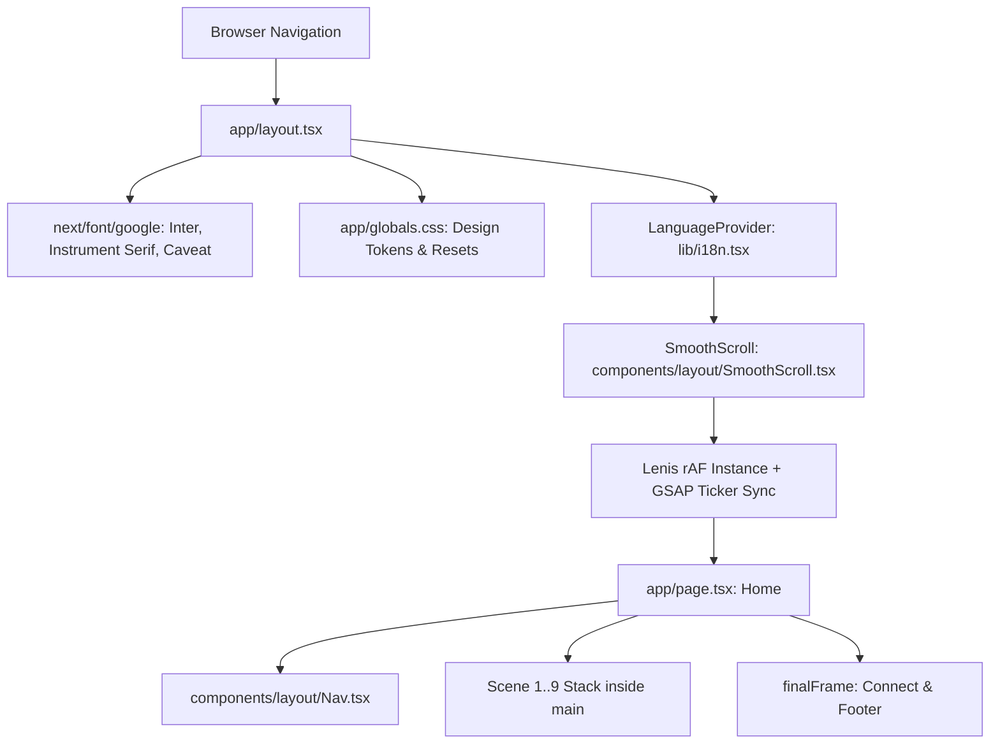

# COMPLETE PORTFOLIO REPOSITORY AUDIT & PROJECT ANALYSIS REPORT

**Audit Date:** September 22, 2026  
**Auditor:** Senior Full-Stack Engineer, Software Architect, UI/UX Engineer, and Code Auditor  
**Repository Name:** `ANBUCHEZHIAN-I-M-Portfolio` (Package: `anbu-portfolio`)  
**Repository Branch:** `main` (Clean working tree)  
**Target Path:** `e:\project\ANBUCHEZHIAN I M - Portfolio`  
**Report File:** `PORTFOLIO_PROJECT_AUDIT_REPORT.md`  

---

## 1. PROJECT DISCOVERY

| Attribute | Detected Value | Verification Evidence |
| :--- | :--- | :--- |
| **Project Name** | `gireesh-portfolio` | `package.json` line 2 |
| **Project Type** | Personal Developer & Product Designer Portfolio | `package.json`, `README.md`, `app/layout.tsx` |
| **Application Type** | Single-Page Application (SPA) with Dynamic Case-Study Routes | `app/page.tsx`, `app/work/[slug]/page.tsx` |
| **Frontend Framework** | **Next.js 16.3.0** (App Router) + **React 19.2.8** + **React-DOM 19.2.8** | `package.json` lines 14–16 |
| **Backend Framework** | **None** (No Node/Express server, no Server Actions, no API routes) | Inspection of `app/` and root (no `api/` directory) |
| **Programming Languages** | **TypeScript 5.x** (strict), **CSS Modules**, **GLSL** (inlined in WebGL) | `tsconfig.json`, `*.module.css`, shader code in `LightJourney.tsx` |
| **Build Tool** | Next.js Internal Bundler (Turbopack / Webpack in Next 16) | `next.config.ts`, `package.json` scripts |
| **Package Manager** | **npm** (lockfile version 3 detected) | `package-lock.json` (226 KB) |
| **CSS Framework** | **Vanilla CSS + CSS Modules + Design Tokens** (No Tailwind) | `app/globals.css`, `components/**/*.module.css` |
| **UI Component Library** | **Custom-built Design System** (No Radix, Shadcn, MUI, or Chakra) | `components/ui/Button.tsx`, `components/layout/Scene.tsx` |
| **Animation Libraries** | **GSAP 3.15.0** (`gsap`, `ScrollTrigger`), **Lenis 1.3.26**, **Three.js 0.185.1** | `package.json` lines 12–17, `lib/gsap.ts`, `lib/lenis.ts` |
| **Icon Libraries** | **None** (Raw inlined SVG paths + PNG raster icons) | `components/sections/Connect/Connect.tsx`, `public/images/icons/` |
| **Database Technology** | **None detected** | No ORM, no SQL, no MongoDB, no database client |
| **Authentication System** | **None detected** | No auth providers, no session cookies, no middleware |
| **API Layer** | **None detected** (Static data read directly from typed `.ts` files) | `content/*.ts` imported directly into components |
| **Deployment Configuration** | Configured for static / SSR deployment via Next.js (`NEXT_PUBLIC_SITE_URL`) | `lib/site.ts`, `app/robots.ts`, `app/sitemap.ts` |
| **Environment Configuration** | 1 environment variable read: `NEXT_PUBLIC_SITE_URL` | `lib/site.ts` line 6 (no `.env` file present in repo) |
| **Testing Setup** | **None detected** (No Jest, Vitest, Cypress, Playwright) | `package.json` has no test script, no test files |
| **Linting Setup** | **ESLint 9** with `eslint-config-next` 16.3.0 (`core-web-vitals`, `typescript`) | `eslint.config.mjs`, `package.json` line 24 |
| **Formatting Setup** | **None detected** (No `.prettierrc` or EditorConfig) | Project root |
| **Git Configuration** | Remote: `https://github.com/gireeshkumarreddy/-Gireesh-Portfolio.git` | `.git/config`, `git status` |
| **TypeScript Config** | Strict mode, target `ES2017`, `moduleResolution: "bundler"`, `@/*` path alias | `tsconfig.json` |

---

## 2. COMPLETE FOLDER STRUCTURE

```
-Gireesh-Portfolio/
├── .git/                                 # Git version control metadata
├── .gitignore                            # Standard Next.js ignore patterns
├── .next/                                # Next.js compilation cache and build output
├── AGENTS.md                             # Next.js 16 agent instructions & warning banner
├── CLAUDE.md                             # Pointer referencing AGENTS.md
├── eslint.config.mjs                     # ESLint 9 flat configuration
├── next-env.d.ts                         # Next.js TypeScript declarations
├── next.config.ts                        # Next.js configuration entrypoint
├── package-lock.json                     # Locked npm dependency tree (v3)
├── package.json                          # Project manifest, dependencies, scripts
├── README.md                             # Comprehensive architectural and scene documentation
├── tsconfig.json                         # TypeScript compiler configuration
├── app/                                  # Next.js App Router root
│   ├── favicon.ico                       # Site favicon
│   ├── globals.css                       # Global design tokens, resets, Lenis root styles
│   ├── layout.tsx                        # Root layout (Fonts, i18n provider, smooth scroll, JSON-LD)
│   ├── not-found.tsx                     # Localized 404 page (EN/FR)
│   ├── page.module.css                   # UNUSED leftover boilerplate from create-next-app
│   ├── page.tsx                          # Primary home page: 10-scene stack architecture
│   ├── robots.ts                         # Dynamic robots.txt metadata route
│   ├── sitemap.ts                        # Dynamic sitemap.xml metadata route
│   ├── tunnel/                           # Standalone lab route for WebGL type tunnel testing
│   │   ├── LabBar.tsx                    # Client-side top navigation bar for lab route
│   │   └── page.tsx                      # Server component wrapping TunnelType preview
│   └── work/                             # Case study dynamic routes
│       └── [slug]/
│           ├── CaseView.tsx              # Client-side case study detail reader (EN/FR)
│           ├── case.module.css           # Styling for case study article layout
│           └── page.tsx                  # Static generation (generateStaticParams + generateMetadata)
├── components/
│   ├── lab/                              # Experimental isolated components
│   │   ├── TunnelType.module.css         # Styling for standalone tunnel type lab
│   │   └── TunnelType.tsx                # Three.js tunnel masked behind GIREESH typography
│   ├── layout/                           # Global chrome and structural wrappers
│   │   ├── LanguageToggle.module.css     # Pill toggle styling
│   │   ├── LanguageToggle.tsx            # EN / FR language switch with animated sliding thumb
│   │   ├── Nav.module.css                # Floating persistent navbar & mobile drawer styles
│   │   ├── Nav.tsx                       # Header with scroll spy, desktop links & mobile drawer
│   │   ├── Scene.module.css              # Sticky hold + runway spacer architecture styles
│   │   ├── Scene.tsx                     # Core 100svh sticky scene hold component
│   │   └── SmoothScroll.tsx              # Lenis smooth-scroll provider & GSAP ticker bridge
│   ├── sections/                         # The 10 individual page scene sections
│   │   ├── About/
│   │   │   ├── About.module.css          # Typography, grid, and metric counter styles
│   │   │   └── About.tsx                 # Identity, philosophy, count-up metrics, education
│   │   ├── Certifications/
│   │   │   ├── Certifications.module.css # 3D sliding panel deck styles
│   │   │   └── Certifications.tsx        # Credential cascade: Right -> Center -> Recede
│   │   ├── Connect/
│   │   │   ├── Connect.module.css        # Memory arc, social buttons, footer styles
│   │   │   └── Connect.tsx               # 5 photo memory arc, social links, copyright footer
│   │   ├── Experience/
│   │   │   ├── Experience.module.css     # Centered stacked panel deck styles
│   │   │   └── Experience.tsx            # 7 career roles on 3D diagonal depth stack
│   │   ├── Gallery/
│   │   │   ├── Gallery.module.css        # Multi-column perspective drift wall styles
│   │   │   └── Gallery.tsx               # DriftWall: 14 photographs drifting upward
│   │   ├── Hero/
│   │   │   ├── Hero.module.css           # Ambient particles, arch frame, stat cards styles
│   │   │   └── Hero.tsx                  # Headline, mouse parallax, stats, portrait arch
│   │   ├── Intro/
│   │   │   ├── TunnelIntro.module.css    # Full-screen tunnel intro overlay styles
│   │   │   └── TunnelIntro.tsx           # Opening scene: Three.js gallery tunnel masked by "GIREESH"
│   │   ├── Journey/
│   │   │   ├── Journey.module.css        # UNUSED legacy CSS 3D perspective styles
│   │   │   ├── Journey.tsx               # UNUSED legacy DOM-based journey implementation
│   │   │   ├── LightJourney.module.css   # Active WebGL light-cable tunnel styles
│   │   │   └── LightJourney.tsx          # Active Scene 4: WebGL GLSL light-cable tunnel
│   │   ├── Stack/
│   │   │   ├── DesignStack.module.css    # Elliptical Archimedean orbit styles
│   │   │   └── DesignStack.tsx           # 23 tools orbiting on an animated Archimedean ellipse
│   │   └── Work/
│   │       ├── Work.module.css           # Perspective card arc styles
│   │       └── Work.tsx                  # 14 featured projects on scrubbable perspective track
│   └── ui/                               # Atomic reusable UI components
│       ├── Button.module.css             # CTA pill button with expanding circular fill
│       ├── Button.tsx                    # Design system CTA button with magnetic hover physics
│       ├── VelocityMarquee.module.css    # Dual-row marquee styling
│       └── VelocityMarquee.tsx           # Scroll-accelerated infinite ticker with direction flip
├── content/                              # Typed static content repositories
│   ├── certifications.ts                 # 5 professional credential records (EN/FR)
│   ├── experience.ts                     # 7 detailed career role records (EN/FR)
│   ├── gallery.ts                        # 14 photograph metadata records with aspect ratios
│   ├── journey.ts                        # 6 chronological career chapters (2021–2026) (EN/FR)
│   ├── projects.ts                       # 14 featured project case studies (72 KB, EN/FR)
│   └── stack.ts                          # 23 software tools grouped into 4 categories
├── lib/                                  # Helper utilities, singletons, and stores
│   ├── gsap.ts                           # GSAP + ScrollTrigger registration & motion tokens
│   ├── i18n.tsx                          # React context store for EN/FR dictionaries & translation
│   ├── lenis.ts                          # Shared Lenis singleton and header-aware hash scroll
│   ├── scene.ts                          # ScrollTrigger trigger resolver for sticky scene runways
│   └── site.ts                           # Global site metadata, canonical URL & author constants
└── public/                               # Static assets served at domain root
    ├── file.svg                          # Default Next.js starter asset (unused)
    ├── globe.svg                         # Default Next.js starter asset (unused)
    ├── next.svg                          # Default Next.js starter asset (unused)
    ├── vercel.svg                        # Default Next.js starter asset (unused)
    ├── window.svg                        # Default Next.js starter asset (unused)
    └── images/                           # Curated portfolio media
        ├── doodle-pencil.png             # UI accent graphic (1.6 KB)
        ├── doodle-wireframe.png          # UI accent graphic (5.8 KB)
        ├── portrait.png                  # Author hero portrait (204 KB)
        ├── companies/                    # 6 employer brand logos (Heeding, Unbias, VRaise, etc.)
        ├── connect/                      # 5 personal memory photos used in Connect arc
        ├── gallery/                      # 14 personal & team photos used in DriftWall
        ├── icons/                        # 4 hero stat card icons (projects, years, countries, etc.)
        ├── issuers/                      # 3 credential logos (Google 480KB, IBM, Microsoft)
        ├── logos/                        # 10 software tool marks (Figma, Notion, Claude, etc.)
        └── projects/                     # 8 project cover images (Avengers, GoT, Reverie, etc.)
```

---

## 3. PACKAGE.JSON & DEPENDENCY AUDIT

### Complete Dependency Inventory

| Package | Version | Category | Where Used | Importance | Notes / Risk |
| :--- | :--- | :--- | :--- | :--- | :--- |
| `next` | `16.3.0` | **Core** | Root framework, routing, SSR/SSG | **Critical** | Next.js 16 with breaking changes (async params, strict React 19 rules). |
| `react` | `19.2.8` | **Core** | Component runtime, hooks, context | **Critical** | React 19 introduces strict effect linting (`react-hooks/set-state-in-effect`). |
| `react-dom` | `19.2.8` | **Core** | DOM renderer for React | **Critical** | Paired with React 19. |
| `gsap` | `^3.15.0` | **Animation** | `lib/gsap.ts`, all section components | **Critical** | Drives all scroll scrubbing, magnetic physics, and entrance timelines. |
| `lenis` | `^1.3.26` | **Animation** | `lib/lenis.ts`, `components/layout/SmoothScroll.tsx` | **Critical** | Provides smooth inertia scrolling synchronized via GSAP ticker. |
| `three` | `^0.185.1` | **Animation / 3D** | `TunnelIntro.tsx`, `LightJourney.tsx`, `TunnelType.tsx` | **Critical** | WebGL rendering for 3D tunnel scenes and GLSL shader cables. |
| `typescript` | `^5` | **Development** | Whole codebase | **Critical** | Type definitions, strict type checking. |
| `@types/node` | `^20` | **Development** | Node environment types | **High** | Type safety for node APIs (`process.env`). |
| `@types/react` | `^19` | **Development** | React type definitions | **High** | Aligned with React 19. |
| `@types/react-dom` | `^19` | **Development** | React DOM type definitions | **High** | Aligned with React 19 DOM. |
| `@types/three` | `^0.185.4` | **Development** | Three.js type definitions | **High** | Type definitions for Three.js geometry, materials, and renderer. |
| `eslint` | `^9` | **Development** | Linting CLI | **Medium** | ESLint 9 Flat Config runner. |
| `eslint-config-next`| `16.3.0` | **Development** | Next.js linting rules | **Medium** | Currently catches 4 errors and 18 warnings in the codebase. |

### Dependency Health & Observations

1. **Absence of Bloat:** The project is remarkably lean. It has ZERO bloated UI packages (no Tailwind, no Framer Motion, no Radix UI, no Lucide, no Lodash, no Axios).
2. **High Synergy:** `gsap` + `lenis` + `three` form a tightly unified rendering pipeline running on a single `requestAnimationFrame` loop via `gsap.ticker`.
3. **No Unused Dependencies:** Every listed runtime dependency (`gsap`, `lenis`, `next`, `react`, `react-dom`, `three`) is actively imported and utilized in production code.

---

## 4. APPLICATION ENTRY POINT & RUNTIME ARCHITECTURE

### Initialization Chain



### Runtime Architecture Breakdown

1. **Root Layout (`app/layout.tsx`):**
   - Configures three Google fonts (`Inter` as `--font-ui`, `Instrument_Serif` as `--font-serif`, `Caveat` as `--font-script`).
   - Imports `app/globals.css` which declares all design tokens and initializes custom scrollbar suppression.
   - Wraps children in `<LanguageProvider>` (pure React context managing `"en"` and `"fr"` state with `localStorage` persistence).
   - Wraps content in `<SmoothScroll>`: initializes Lenis at `lerp: 0.1`, binds `lenis.on("scroll", ScrollTrigger.update)`, and attaches `lenis.raf` to `gsap.ticker`.
   - Injects Schema.org JSON-LD structured data for `Person`.
2. **Page Orchestration (`app/page.tsx`):**
   - Renders `<Nav />` (fixed header with scroll-spy, animated logo, language toggle, and mobile menu).
   - Renders `<main>` containing 9 `<Scene>` instances followed by `.finalFrame` containing `<Connect />`.
   - **Scene Stack Mechanism (`components/layout/Scene.tsx`):**
     - Each scene outputs two adjacent siblings into `<main>`:
       1. `<div className={styles.hold} data-scene={id} style={{ zIndex: order }}>`: Positioned `sticky; top: 0; height: 100svh; overflow: hidden; isolation: isolate; background: var(--bg)`.
       2. `<div className={styles.runway} data-runway={id} style={{ height: calc(runway * 100svh) }}>`: An invisible empty spacer providing the scroll track.
     - As the user scrolls through the runway, native sticky holds the outgoing frame fixed in the viewport while the incoming scene (with higher `order` / `zIndex`) slides up from the bottom and covers it.
     - ScrollTrigger reads progress via `sceneScrub()` off the runway sibling, ensuring scrubbable reversed physics.
3. **Closing Frame (`.finalFrame`):**
   - The `<Connect />` component is taller than the viewport and is placed in a non-sticky `.finalFrame` container (`z-index: 20; background: var(--bg)`), allowing it to slide over Scene 9 (Gallery) and flow naturally into the footer.

---

## 5. ROUTING AUDIT

| Route | File Path | Type | Status | Key Components & Purpose |
| :--- | :--- | :--- | :--- | :--- |
| `/` | `app/page.tsx` | Static / SSR | **Active** | 10 stacked scenes: Intro, Hero, About, Journey, Stack, Work, Experience, Credentials, Gallery, Connect. |
| `/work/[slug]` | `app/work/[slug]/page.tsx` | Dynamic SSG | **Active** | Statically generates 14 project case study pages via `generateStaticParams()`. Client body in `CaseView.tsx`. |
| `/tunnel` | `app/tunnel/page.tsx` | Static Lab | **Experimental** | Isolated preview of Three.js typography tunnel. Set to `robots: { index: false }`. |
| `404` | `app/not-found.tsx` | Custom Error | **Active** | Full-screen localized error page with return-home CTA. |
| `/sitemap.xml` | `app/sitemap.ts` | Dynamic Route | **Active** | Generates XML sitemap covering `/` and all 14 `/work/[slug]` paths. |
| `/robots.txt` | `app/robots.ts` | Dynamic Route | **Active** | Emits `allow: /` and links to sitemap. |

- **Routing System:** Pure Next.js App Router (file-based). No external routing libraries.
- **Admin / Dashboards:** None detected.
- **Hidden Routes:** `/tunnel` (lab route, unindexed).

---

## 6. COMPLETE UI COMPONENT AUDIT

### Component Inventory by Category

#### 1. Navigation
- **`components/layout/Nav.tsx` (`Nav.module.css`):**
  - **Props:** None.
  - **State:** `active` (active section id via ScrollTrigger scroll-spy), `menuOpen` (boolean for mobile drawer).
  - **Behavior:** Fixed header. Compresses slightly on scroll (`styles.scrolled`). Links roll vertically on hover. Below 900px, switches to a drawer with hamburger trigger and backdrop scrim. Closes on `Escape` key and page locks.

#### 2. Hero
- **`components/sections/Hero/Hero.tsx` (`Hero.module.css`):**
  - **Props:** None.
  - **State:** None (GSAP-driven).
  - **Behavior:** Entrance timeline triggers when revealed by Intro tunnel. Counts up 4 stat cards (Projects: 20+, Years: 2+, Technologies: 20+, Satisfaction: 100%). Multi-layer mouse parallax on ambient glows, rings, particles, and portrait arch.

#### 3. About
- **`components/sections/About/About.tsx` (`About.module.css`):**
  - **Props:** None.
  - **State:** None.
  - **Behavior:** Renders `<VelocityMarquee />`, 4 count-up business metrics (`1st`, `3+`, `$70K+`, `1B+`), education text, and CTA button.

#### 4. Journey (Career Story)
- **`components/sections/Journey/LightJourney.tsx` (`LightJourney.module.css`) [ACTIVE]:**
  - **Props:** None.
  - **State:** `webglOk` (boolean), `staticMode` (boolean for reduced motion fallback).
  - **Behavior:** 6 viewports of scroll runway. 20 wavy 3D light cables (10 on mobile) converging to a vanishing point. Custom GLSL shaders render traveling additive pulses. Scrubbed scroll advances 6 career chapters (2021–2026). At completion, light intensity peaks and dissolves into white.
- **`components/sections/Journey/Journey.tsx` (`Journey.module.css`) [UNUSED LEGACY]:**
  - An earlier CSS `perspective` / `translateZ` prototype with 7 hardcoded English chapters. Not imported anywhere.

#### 5. Skills / Toolkit
- **`components/sections/Stack/DesignStack.tsx` (`DesignStack.module.css`):**
  - **Props:** None.
  - **State:** None.
  - **Behavior:** 23 tool cards orbiting in an Archimedean elliptical spiral. Arc-length reparameterization ensures uniform spacing. Tangent-derived banking lean. Responsive card sizing and mobile inner clearance. Stops animating via IntersectionObserver when off-screen.

#### 6. Projects / Work
- **`components/sections/Work/Work.tsx` (`Work.module.css`):**
  - **Props:** None.
  - **State:** None.
  - **Behavior:** 14 projects displayed on a 3D perspective curved card arc. As user scrolls the 4.5vh runway, cards scrub across center: center card is frontal, neighbors rotate in `rotationY` and recede in Z. On mobile/touch/reduced-motion, degrades to a clean native CSS horizontal snap carousel.

#### 7. Experience
- **`components/sections/Experience/Experience.tsx` (`Experience.module.css`):**
  - **Props:** None.
  - **State:** None.
  - **Behavior:** 7 career roles rendered as wide, short boards on a centered 3D diagonal depth stack. Active board is in front; waiting boards sit up, right, and back with waiting identity text only; passed boards exit downward with blur and dissolve. Clicking any board jumps directly to it. On mobile, releases into a vertical board stack.

#### 8. Certifications / Credentials
- **`components/sections/Certifications/Certifications.tsx` (`Certifications.module.css`):**
  - **Props:** None.
  - **State:** None.
  - **Behavior:** 5 credential panels moving in a right-to-center-to-background cascade. Active panel sits centered; passed panels recede straight back in Z as depth layers. On mobile, releases into stacked cards.

#### 9. Gallery
- **`components/sections/Gallery/Gallery.tsx` (`Gallery.module.css`):**
  - **Props:** None.
  - **State:** `cols` (dynamic column count based on viewport width).
  - **Behavior:** DriftWall rendering 14 authentic personal/team photos across 2–4 columns. Columns drift continuously upward at variable speeds with seamless wrap. Scrolling adds a vertical surge. Fine pointers lean the wall in 3D parallax.

#### 10. Connect & Footer
- **`components/sections/Connect/Connect.tsx` (`Connect.module.css`):**
  - **Props:** None.
  - **State:** None.
  - **Behavior:** 5 personal memory photos arranged on a 3D curved arc that leans with cursor movement. 4 interactive social links with rolling text and expanding circle fill. Site credit and copyright footer.

#### 11. UI Primitives & Special Effects
- **`components/ui/Button.tsx` (`Button.module.css`):**
  - **Props:** `href`, `children`, `variant` (`primary` | `dark` | `ghost`), `size`, `arrow`, `lead`, `magnetic`, `className`, `onClick`.
  - **Behavior:** Magnetic pull toward pointer (via `gsap.quickTo`). Expanding circular fill on hover/tap. Rolling label stack. Rotating arrow (-45°).
- **`components/ui/VelocityMarquee.tsx` (`VelocityMarquee.module.css`):**
  - **Props:** `rows: MarqueeRow[]`.
  - **Behavior:** Continuous dual-row marquee. Tracks scroll velocity and accelerates drift up to 2.2x. Scrolling up reverses direction.
- **`components/sections/Intro/TunnelIntro.tsx` (`TunnelIntro.module.css`):**
  - Three.js WebGL gallery tunnel rendered behind a compositor CSS canvas mask in the shape of `"GIREESH"`. Camera accelerates through tunnel on scroll; fog dissolves to pure white at completion.

---

## 7. PAGE-BY-PAGE UI ANALYSIS

### Home Page (`/`)

- **Layout Structure:**
  - Full-screen stacked architecture. `<main>` holds 9 sticky `100svh` scenes each paired with a scroll runway. Scene 10 (`Connect`) sits in a static `.finalFrame` that covers Scene 9 and scrolls naturally to the footer.
- **Typography:**
  - Primary UI Font: `Inter` (`--font-ui`)
  - Editorial Accent Font: `Instrument Serif` italic (`--font-serif`)
  - Script Accent Font: `Caveat` (`--font-script`)
  - Fluid sizing using `clamp()` (e.g., `clamp(40px, 7vw, 88px)` for major section headers).
- **Colors:**
  - Pure white ground (`--bg: #ffffff`)
  - Deep carbon ink (`--ink: #141414`), slate secondary (`--ink-2: #3c3c42`), cool grey tertiary (`--ink-3: #8a8a90`)
  - Vibrant vermilion accent (`--accent: #ff2e0f`, `--accent-dark: #e02000`)
  - Subtle borders (`--line: #ededef`)
- **Animations:**
  - Three.js WebGL rendering, GSAP ScrollTrigger timeline reveals, cursor parallax, count-up numbers, velocity marquees, magnetic physics.
- **Responsive Behavior:**
  - Desktop (>1000px): Full cinematic sticky stack.
  - Mobile (<=1000px): Tall content scenes (Hero, About, Stack, Work, Experience, Credentials) release `position: sticky` and become natural scrolling documents (`height: auto`). Single-screen scenes (`Intro`, `Journey`, `Gallery`) retain their cinematic `100svh` frame (`keepOnMobile`).
- **Content Origin:** All content is loaded statically from typed records in `content/*.ts` with bilingual dictionary lookups via `lib/i18n.tsx`.

### Case Study Detail Route (`/work/[slug]`)

- **Layout Structure:**
  - Top navigation bar with back link, home logo, and language toggle.
  - Centered editorial container (`max-width: 860px`).
  - Hero header: kicker, year, title, one-liner, metadata grid (Role, Timeline, Focus, Live Site, GitHub Repo), cover visual.
  - Structured narrative sections: Context, Problem, Process (numbered 01..0N), Design Decisions, Outcomes, Reflection, and Next Project link.
- **Content Origin:** `PROJECTS` array in `content/projects.ts`. Dynamic route parameters statically pre-rendered via `generateStaticParams()`.

### Lab Route (`/tunnel`)

- **Layout Structure:** Full-screen viewport (`100svh`) with absolute top bar (`LabBar`) and embedded Three.js `TunnelType` canvas.
- **Content Origin:** Hardcoded text `"GIREESH"` masking the Three.js camera.

### 404 Route (`app/not-found.tsx`)

- **Layout Structure:** Centered minimal flexbox column (`minHeight: 100svh`).
- **Content Origin:** Localized keys (`nf.label`, `nf.h1`, `nf.h1Em`, `nf.cta`) from `lib/i18n.tsx`.

---

## 8. DESIGN SYSTEM AUDIT

### Design Tokens (`app/globals.css`)

| Design Token | Current Value | CSS Variable | Usage |
| :--- | :--- | :--- | :--- |
| **Background** | `#ffffff` | `--bg` | Page background, scene surfaces, cards |
| **Primary Ink** | `#141414` | `--ink` | Headings, high-contrast labels, buttons |
| **Secondary Ink** | `#3c3c42` | `--ink-2` | Body text, sub-headlines, descriptions |
| **Tertiary Ink** | `#8a8a90` | `--ink-3` | Captions, kickers, timestamps, dividers |
| **Primary Accent** | `#ff2e0f` | `--accent` | Brand vermilion, highlights, selections |
| **Accent Dark** | `#e02000` | `--accent-dark` | Hover / active states for buttons |
| **Line / Border** | `#ededef` | `--line` | Card borders, subtle separating rules |
| **Placeholder** | `#f2f2f3` | `--ph` | Image loading plates, skeleton grounds |
| **Standard Shadow** | `0 24px 60px -12px rgba(20,20,20,0.1), 0 4px 16px rgba(...)` | `--shadow` | Floating cards, navigation bar |
| **Deep Shadow** | `0 48px 110px -20px rgba(20,20,20,0.18), 0 8px 28px rgba(...)` | `--shadow-lg` | Active 3D stage panels, modals |
| **Corner Radius** | `22px` | `--radius` | Cards, panels, cover images |
| **Container Max** | `1280px` | `--max` | Page content maximum width |
| **Header Offset** | `104px` | `--nav-offset` | Scroll anchor jump offset |
| **Expo Easing** | `cubic-bezier(0.16, 1, 0.3, 1)` | `--ease-out-expo` | Button hovers, panel transformations |
| **Fast Duration** | `200ms` | `--dur-fast` | Micro-interactions |
| **Base Duration** | `400ms` | `--dur-base` | State transitions |

### Design System Evaluation

- **Status:** **Consistent & Component-Driven**.
- The token architecture in `app/globals.css` is rigorously honored across CSS Modules.
- Components use CSS Modules (`[Component].module.css`) with local variables mapped to global design tokens.
- No Tailwind classes exist in actual markup; styling is 100% scoped CSS Modules.

---

## 9. ANIMATION & INTERACTION AUDIT

| Animation Feature | Implementation File | Trigger Mechanism | Target Element | Performance / GPU Impact | Reduced Motion Support |
| :--- | :--- | :--- | :--- | :--- | :--- |
| **Smooth Scroll** | `lib/lenis.ts`, `SmoothScroll.tsx` | Wheel / Touch / Keyboard | Global HTML scroll | High efficiency (single rAF via GSAP ticker) | Bypassed completely if reduced motion preferred |
| **Sticky Scene Stack** | `Scene.tsx`, `Scene.module.css` | Native scroll across runway | 100svh Scene holds | Zero JS overhead (native browser sticky) | Holds release to static flow; runways collapse |
| **WebGL Intro Tunnel** | `TunnelIntro.tsx` | Scroll progress (0 -> 1) | Three.js WebGL canvas | High GPU load; capped DPR (1.5x mobile, 2x desktop) | Renders single static frame without animation |
| **Typography Masking** | `TunnelIntro.tsx`, `TunnelType.tsx` | Window resize | Canvas CSS `-webkit-mask-image` | Compositor-level GPU masking | Kept as static mask |
| **Light Cable Tunnel** | `LightJourney.tsx` | Scroll scrub across 6 viewports | Custom GLSL vertex & fragment shaders | Moderate to High GPU; 10 cables on mobile, 20 desktop | Falls back to static readable chapter stack |
| **Spiral Orbit** | `DesignStack.tsx` | Delta-time ticker (IntersectionObserver gated) | 23 DOM card elements | Ultra-light (~0.15ms per frame, transform only) | Static grid layout |
| **Perspective Card Arc** | `Work.tsx` | ScrollTrigger scrub (4.5vh runway) | 14 Project card articles | GPU transform & opacity only | Native horizontal CSS snap carousel |
| **Diagonal Panel Deck** | `Experience.tsx` | ScrollTrigger scrub + rAF interpolation | 7 Experience boards | GPU `translate3d`, `scale`, `filter: blur` | Vertical stacked boards |
| **Credential Cascade** | `Certifications.tsx`| ScrollTrigger scrub + rAF interpolation | 5 Credential panels | GPU `translate3d`, `scale` | Standard stacked cards |
| **DriftWall Gallery** | `Gallery.tsx` | Autonomous rAF drift + scroll velocity + pointer | 14 Gallery image tiles across columns | Lightweight GPU transforms; stops when off-screen | Static photo grid |
| **Magnetic CTA Button** | `Button.tsx` | Pointer move on fine-pointer devices | Anchor tag (`<a>`) | `gsap.quickTo` GPU translate | Disabled on reduced motion & touch |
| **Velocity Marquee** | `VelocityMarquee.tsx`| rAF ticker + scroll velocity calculation | Dual marquee track elements | Seamless wrap via `gsap.utils.wrap` | Static horizontal list |
| **Memory Arc Parallax** | `Connect.tsx` | Pointer move | 5 photo panels in 3D space | `gsap.quickTo` rotationX and rotationY | Gentle static arc |

---

## 10. ASSET AUDIT

### Local Media Inventory (`public/images/`)

1. **Root Assets:**
   - `portrait.png` (204 KB): Hero cut-out portrait of Gireesh.
   - `doodle-pencil.png` (1.6 KB), `doodle-wireframe.png` (5.8 KB): Decorative sketch graphics.
2. **Company Logos (`public/images/companies/`):**
   - `heeding.png` (73.7 KB), `unbias.png` (7.0 KB), `vraise.jpg` (3.2 KB), `oigetit.jpg` (3.3 KB), `sage.jpg` (2.6 KB), `tutorac.jpg` (1.5 KB).
3. **Connect Memories (`public/images/connect/`):**
   - `moment-1.jpg` to `moment-5.jpg` (ranging from 41 KB to 107 KB): Personal photographs of Gireesh in various life/career settings.
4. **Gallery Photographs (`public/images/gallery/`):**
   - `g01.jpg` to `g14.jpg` (ranging from 52 KB to 270 KB, totaling ~2.1 MB): Authentic photos of Gireesh, teams, hackathons, and moments in France/India.
5. **UI Icons (`public/images/icons/`):**
   - `projects.png`, `years.png`, `countries.png`, `satisfaction.png` (~600–770 bytes each): Stat card badge icons.
6. **Credential Issuer Marks (`public/images/issuers/`):**
   - `google.png` (**480 KB** — large uncompressed asset!), `ibm.png` (13.6 KB), `microsoft.png` (42.2 KB).
7. **Tool Logos (`public/images/logos/`):**
   - `capcut.png`, `chatgpt.png`, `claude.png`, `figma.png`, `flow.png`, `framer.png`, `midjourney.png`, `notion.png`, `pinterest.png`, `spline.png` (~590B to 1.9KB each).
8. **Project Covers (`public/images/projects/`):**
   - `avengers-cover.jpg` (217 KB), `bahubali-cover.jpg` (28 KB), `ghostrider-cover.jpg` (81 KB), `got-cover.jpg` (189 KB), `habu-cover.jpg` (43 KB), `reverie-cover.jpg` (88 KB), `spiderman-cover.jpg` (56 KB), `vistarail-cover.jpg` (77 KB).

### External Assets

- **Cloudflare Image Delivery CDN:**
  - 5 images hardcoded in `components/lab/TunnelType.tsx` and `components/sections/Intro/TunnelIntro.tsx`:
    - `https://imagedelivery.net/IEUjvl3YUlxY-MrTpOAWDQ/f8b3688c-11d0-425c-0b6f-66f133322c00/w=800`
    - `https://imagedelivery.net/IEUjvl3YUlxY-MrTpOAWDQ/c083d83a-f5a4-4434-989f-4eaa9bbe7500/w=800`
    - `https://imagedelivery.net/IEUjvl3YUlxY-MrTpOAWDQ/12e8b0be-f114-4134-1ab7-53116bfc2800/w=800`
    - `https://imagedelivery.net/IEUjvl3YUlxY-MrTpOAWDQ/b14ae2a2-1116-4a7f-0a18-1d74c4a46f00/w=800`
    - `https://imagedelivery.net/IEUjvl3YUlxY-MrTpOAWDQ/babdb603-8b5b-4520-58d6-240a34463c00/w=800`

### Unused Boilerplate Assets

- `public/next.svg` (1.3 KB)
- `public/vercel.svg` (128 B)
- `public/file.svg` (391 B)
- `public/globe.svg` (1.0 KB)
- `public/window.svg` (385 B)

---

## 11. DATA FLOW AUDIT

### Architectural Data Flow Pattern

```
content/[category].ts (Typed Schema Arrays)
       ↓
Imported at Build/Render Time
       ↓
Section Components (app/page.tsx / app/work/[slug])
       ↓
Language Hook Lookup: L(lang, item, "field") & t("key")
       ↓
Rendered DOM Elements & 3D Shaders
```

### Data Stores Inventory

1. **`content/projects.ts` (72 KB):**
   - 14 full project objects conforming to the `Project` type. Includes rich metadata, case study narrative steps (Context, Problem, Process, Decisions, Outcomes, Reflection), live URLs, and French localized overrides (`fr`).
2. **`content/experience.ts` (12.3 KB):**
   - 7 career role objects conforming to the `Role` type. Details company name, role title, employment type, location, dates, summary, achievements, outcomes, skills, panel colors, and company logo variants.
3. **`content/journey.ts` (7.6 KB):**
   - 6 career chapter objects conforming to the `Chapter` type (2021–2026), tracking progression from Telangana to France.
4. **`content/certifications.ts` (5.7 KB):**
   - 5 credential records conforming to the `Cert` type with issuer references, verification status, and skills.
5. **`content/stack.ts` (2.2 KB):**
   - 23 tools grouped into AI, Design, Build, and Creative categories.
6. **`content/gallery.ts` (2.3 KB):**
   - 14 photograph records with true aspect ratios, display scales, and vertical offsets.
7. **`lib/i18n.tsx` (13.5 KB):**
   - Master UI translation dictionary covering navigation, section kickers, headings, button labels, and case study section headers.

---

## 12. BACKEND / API AUDIT

**No backend detected.**
- There are no API routes (`app/api/` does not exist).
- There are no Next.js Server Actions (`"use server"` is not used anywhere in the codebase).
- There is no database layer, no ORM, no API client, and no external webhook endpoints.
- Contact actions are handled exclusively via native `mailto:` links.

---

## 13. DATABASE AUDIT

**No database detected.**
- No relational or NoSQL database is configured.
- No schema files, migrations, seed scripts, or ORMs (Prisma, Drizzle, Mongoose, Supabase, Firebase) exist in the repository.

---

## 14. AUTHENTICATION & SECURITY AUDIT

### Authentication
- **No authentication detected.** (No login, signup, JWTs, OAuth, cookies, or protected routes).

### Security Analysis
- **Secret Scanning:** No exposed private API keys, tokens, or credentials exist in the codebase.
- **Client-Side Environment Variables:** Only `NEXT_PUBLIC_SITE_URL` is referenced (`lib/site.ts`).
- **External Network Requests:** Three.js texture loaders in `TunnelIntro.tsx` and `TunnelType.tsx` fetch images from an external Cloudflare CDN (`https://imagedelivery.net/...`). If these external URLs ever become unreachable, the loader silently fails and leaves slabs blank.
- **Injection Safety:** The only instance of `dangerouslySetInnerHTML` is in `app/layout.tsx` for injecting static Schema.org JSON-LD, which is safe.

---

## 15. ENVIRONMENT VARIABLES AUDIT

| Variable | Used By | Purpose | Public/Private | Default Fallback |
| :--- | :--- | :--- | :--- | :--- |
| `NEXT_PUBLIC_SITE_URL` | `lib/site.ts`, `app/layout.tsx`, `app/robots.ts`, `app/sitemap.ts` | Sets canonical URL for OpenGraph, Twitter cards, sitemap, and robots | **Public** | `"http://localhost:3000"` |

*(No other environment variables are referenced or required in the repository).*

---

## 16. RESPONSIVENESS AUDIT

### Breakpoints Identified

- `1400px`: Gallery 4-column wide grid
- `1100px`: Work section perspective arc disables below 1101px; Gallery shifts to 4 compact columns
- `1000px`: **Primary Desktop/Mobile Boundary**:
  - Scenes in `Scene.module.css` release `position: sticky` and expand to natural height.
  - Scene runways (`data-runway`) collapse to `display: none`.
  - `Experience` and `Certifications` shift from 3D stacked decks to vertical linear layouts.
  - Three.js light cables in `LightJourney.tsx` reduce from 20 to 10 cables.
- `900px`: Navigation switches from desktop horizontal link bar to mobile hamburger drawer.
- `700px`: Stack orbit switches from wide ellipse (`INNER_WIDE = 0.4`) to compact mode (`INNER_COMPACT = 0.62`), cards resize to 52px; Gallery shifts to 3 columns.
- `600px`: Mobile hero typography tightening.

### Responsive Weaknesses & Risks

1. **Fixed Canvas Sizing:** On mobile, `keepOnMobile` scenes (`Intro`, `Journey`, `Gallery`) hold 100svh. While optimized, Three.js on low-end mobile devices can cause frame drops.
2. **Horizontal Overflow Risk:** On very narrow screens (<360px), `DesignStack` cards allow horizontal overflow so the orbit clears text, which could cause slight sideways scroll if not contained by `body { overflow-x: clip }`.

---

## 17. ACCESSIBILITY AUDIT

| Area | Status | Repository Evidence / Implementation |
| :--- | :--- | :--- |
| **Reduced Motion** | **Excellent** | Comprehensive `prefers-reduced-motion` fallbacks across every component (`lib/gsap.ts`, `Scene.module.css`, `SmoothScroll.tsx`, `Hero.tsx`, `Work.tsx`, `VelocityMarquee.tsx`, `TunnelIntro.tsx`, `LightJourney.tsx`). Entire sticky scene stack releases to static readable documents. |
| **Screen Readers** | **Good** | `aria-hidden="true"` applied to decorative particles, canvas backgrounds, and marquee duplicates. Accessible summary paragraphs (`srOnly`) provided for marquees. |
| **Keyboard Navigation** | **Good** | Mobile drawer locks focus and closes on `Escape`. Buttons have visible `:focus-visible` outlines. |
| **Semantic HTML** | **Good** | Clean use of `<main>`, `<header>`, `<nav>`, `<section>`, `<article>`, `<h1>`-`<h3>`, `<footer>`. |
| **Color Contrast** | **Good** | High contrast dark ink (`#141414`) on white (`#ffffff`). Card covers define explicit matching ink colors (`"light"` vs `"dark"`). |
| **Image Alt Text** | **Needs Attention** | Some images use empty `alt=""` or generic labels. Multiple raw `` tags trigger Next.js linter warnings. |

---

## 18. SEO AUDIT

- **Page Titles & Meta Descriptions:** Configured in `app/layout.tsx` using Next.js Metadata API with title templates.
- **OpenGraph & Twitter Cards:** Configured with `type: "website"`, locale, image summary cards.
- **Canonical URLs:** Handled via `metadataBase: new URL(SITE_URL)`.
- **Structured Data:** Inlines Schema.org `Person` JSON-LD in `app/layout.tsx` with name, jobTitle, email, address, and social links (`sameAs`).
- **Dynamic Sitemap:** `app/sitemap.ts` dynamically maps `/` and all 14 `/work/[slug]` routes.
- **Robots Route:** `app/robots.ts` allows all crawlers and points to `/sitemap.xml`.
- **Dynamic Case Study SEO:** `app/work/[slug]/page.tsx` exports `generateMetadata()` for dynamic title and description per project.

---

## 19. PERFORMANCE AUDIT

### Bottlenecks & Optimization Opportunities

1. **Unoptimized Next.js Images (`@next/next/no-img-element`):**
   - 18 linter warnings are triggered because standard `` tags are used in `CaseView.tsx`, `Certifications.tsx`, `Connect.tsx`, `Experience.tsx`, `Gallery.tsx`, `Hero.tsx`, `DesignStack.tsx`, and `Work.tsx` instead of `next/image`.
   - Result: Images are not automatically converted to WebP/AVIF or dynamically resized by Next.js.
2. **Heavy Image Assets in `public/images/`:**
   - `public/images/issuers/google.png` is **480 KB** (uncompressed).
   - `public/images/portrait.png` is **204 KB**.
   - `public/images/gallery/` contains 14 JPGs totaling over **2.1 MB**.
3. **Three.js WebGL Overhead:**
   - Two separate Three.js scenes run on the main page (`TunnelIntro` and `LightJourney`). Both include texture loaders and animation loops. While DPR caps and `IntersectionObserver` gating are implemented, this can be heavy on battery-constrained mobile hardware.
4. **Third-Party CDN Dependencies:**
   - Cloudflare CDN images inside Three.js loaders introduce external network latency on first load.

---

## 20. CODE QUALITY AUDIT

### Categorized Findings

#### Critical Issues (Breaks Builds / Strict Linting)
- **4 ESLint Errors (`react-hooks/set-state-in-effect`):**
  - Next.js 16 and React 19 flag synchronous `setState` calls inside `useEffect`:
    1. `components/lab/TunnelType.tsx` (line 87): `setWebglOk(false);`
    2. `components/sections/Intro/TunnelIntro.tsx` (line 99): `setWebglOk(false);`
    3. `components/sections/Journey/LightJourney.tsx` (line 100): `if (reduced) setStaticMode(true);`
    4. `lib/i18n.tsx` (line 239): `setLangState(saved);`
  - *Impact:* `npm run lint` fails with exit code 1.

#### High Priority Issues (Architectural Debt)
- **Unused Legacy Components:**
  - `components/sections/Journey/Journey.tsx` and `Journey.module.css` (275 lines) are completely dead code replaced by `LightJourney.tsx`.
- **Unused Stylesheet:**
  - `app/page.module.css` (151 lines) is default Next.js starter boilerplate and is never imported by `app/page.tsx`.

#### Medium Priority Issues (Optimization & Standards)
- **Standard `` instead of `<Image />`:**
  - Used in 8 components, causing 10+ ESLint warnings and missing out on automatic Next.js image optimization.
- **Unused Declarations:**
  - `JOURNEY_VIEWPORTS` in `TunnelIntro.tsx` and `LightJourney.tsx`.
  - `STEP_VH` in `Certifications.tsx` and `Experience.tsx`.
  - `PIN_PER_CARD` in `Work.tsx`.
  - `prefersReducedMotion` in `Work.tsx`.

#### Low Priority Issues (Cleanliness)
- Unused SVG assets from `create-next-app` in `public/` (`file.svg`, `globe.svg`, `next.svg`, `vercel.svg`, `window.svg`).

---

## 21. TEMPLATE / DEMO CONTENT AUDIT

The current repository contains the personal identity, career history, and project portfolio of **Gireesh Kumar Reddy Kolli**. Every instance of this content must be replaced when customizing the portfolio for a new developer:

| Current Template Content | File Location | Specific Details / Current Value |
| :--- | :--- | :--- |
| **Full Name** | `lib/site.ts`, `app/layout.tsx`, `README.md` | `"Gireesh Kumar Reddy Kolli"` |
| **Short Display Name** | `Nav.tsx`, `TunnelIntro.tsx`, `Connect.tsx` | `"GIREESH"` / `"Gireesh"` |
| **Professional Title** | `lib/site.ts`, `app/layout.tsx`, `i18n.tsx` | `"Product Designer & UX Consultant"` |
| **Geographic Location** | `lib/site.ts`, `app/layout.tsx`, `journey.ts` | `"Antibes, France"` / `"Sophia Antipolis"` |
| **Email Address** | `lib/site.ts`, `app/layout.tsx`, `Connect.tsx` | `anbuchezhianim24@gmail.com` |
| **Social Links** | `lib/site.ts`, `Connect.tsx` | `linkedin.com/in/anbuchezhianilanchezhian`, `github.com/Anbuchezhian24` |
| **Bio / Hero Subtitle** | `app/layout.tsx`, `lib/i18n.tsx` | `"Products that feel obvious. Design that isn't..."` |
| **Education Record** | `content/journey.ts`, `lib/i18n.tsx` | `"MSc International Business · Montpellier Business School · 2024–2026"` |
| **Career Journey** | `content/journey.ts` (6 chapters) | Roots in Telangana, Tutorac, Sage Finance, Move to France, Heeding |
| **Work History / Roles** | `content/experience.ts` (7 roles) | Heeding Climate Solutions, UNBIAS Hackathon, V Raise, Oigetit, Site Web & Co, Sage Finance, Tutorac |
| **Credentials** | `content/certifications.ts` (5 records) | Power Platform, Google Digital Marketing, SEO & Content, Business Analysis, IBM AI Foundations |
| **Project Case Studies** | `content/projects.ts` (14 projects) | Heeding Marketplace, LockAI, Price Intelligence, Avengers Doomsday, GoT, Baahubali, Ghost Rider, Habu, VistaRail, Reverie, Spider-Man, etc. |
| **Personal Photographs** | `public/images/portrait.png`, `gallery/`, `connect/` | 19 personal photographs of Gireesh, his colleagues, and events |
| **3D Typography Mask** | `TunnelIntro.tsx`, `TunnelType.tsx` | Canvas string `"GIREESH"` rendered in WebGL |

---

## 22. HARD-CODED CONTENT AUDIT

### Content Classification

1. **Content that must become personal (New Owner):**
   - Personal identity in `lib/site.ts` (`PERSON` object).
   - Biography, kicker, and hero statements in `lib/i18n.tsx`.
   - Career timeline in `content/journey.ts`.
   - Experience entries in `content/experience.ts`.
   - Project list and case studies in `content/projects.ts`.
   - Personal media files in `public/images/`.
2. **Content that should remain structural (Architecture):**
   - Sticky scene hold and runway system (`components/layout/Scene.tsx`, `lib/scene.ts`).
   - Smooth scroll integration (`components/layout/SmoothScroll.tsx`, `lib/lenis.ts`).
   - Navigation scroll-spy and mobile drawer (`components/layout/Nav.tsx`).
   - Button interaction physics and tokens (`components/ui/Button.tsx`).
   - Design tokens, CSS variables, and layout resets (`app/globals.css`).
3. **Content that should become configurable:**
   - The typography string used in the 3D intro mask (currently hardcoded as `"GIREESH"` in `TunnelIntro.tsx` and `TunnelType.tsx`).
   - The enabled scene list in `app/page.tsx`.
   - Social links array in `Connect.tsx` (should read from `lib/site.ts` instead of local constant).
4. **Demo / Temporary Data:**
   - Lab test route (`app/tunnel/`).
   - Unused legacy journey component (`components/sections/Journey/Journey.tsx`).

---

## 23. PROJECT CUSTOMIZATION MAP

```
┌────────────────────────────────────────────────────────────────────────┐
│                        PROJECT CUSTOMIZATION MAP                       │
├────────────────────────────────────────────────────────────────────────┤
│ KEEP (Architectural Foundations)                                       │
│  - Next.js 16 App Router + TypeScript setup                            │
│  - Sticky Scene stack runway architecture (Scene.tsx, lib/scene.ts)    │
│  - GSAP + Lenis rAF ticker integration (SmoothScroll.tsx, lib/lenis.ts)│
│  - Custom Design System (app/globals.css tokens, Button.tsx)           │
│  - Bilingual i18n React Context (lib/i18n.tsx)                         │
│  - Dynamic SSG Case Study engine (app/work/[slug])                     │
├────────────────────────────────────────────────────────────────────────┤
│ MODIFY (Adapt to New Developer Identity)                               │
│  - lib/site.ts: Replace name, email, location, and social URLs         │
│  - lib/i18n.tsx: Rewrite EN/FR copy for Hero, About, and Connect       │
│  - content/stack.ts: Update to developer's actual tech stack           │
│  - components/sections/Intro/TunnelIntro.tsx: Change text mask name    │
│  - components/sections/Connect/Connect.tsx: Link to updated socials    │
├────────────────────────────────────────────────────────────────────────┤
│ REPLACE (Complete Data & Asset Replacement)                            │
│  - content/projects.ts: Replace with developer's real software projects│
│  - content/experience.ts: Replace with developer's employment history  │
│  - content/journey.ts: Replace with developer's personal journey       │
│  - content/certifications.ts: Replace with developer's credentials     │
│  - public/images/portrait.png: Replace with developer's headshot       │
│  - public/images/gallery/ & connect/: Replace with developer's photos  │
│  - public/images/projects/: Replace with software UI screenshots       │
├────────────────────────────────────────────────────────────────────────┤
│ REMOVE (Dead Code & Boilerplate Cleanup)                               │
│  - components/sections/Journey/Journey.tsx & Journey.module.css        │
│  - app/page.module.css (Unused create-next-app CSS)                    │
│  - public/next.svg, vercel.svg, globe.svg, file.svg, window.svg        │
├────────────────────────────────────────────────────────────────────────┤
│ ADD (Essential Developer Portfolio Features)                           │
│  - Live Contact Form or API route (e.g. Resend / Web3Forms)            │
│  - Developer-specific case study fields (Architecture, Code, Stack)    │
│  - Downloadable Resume / CV button and PDF asset                       │
│  - Fix for React 19 ESLint setState-in-effect warnings                 │
└────────────────────────────────────────────────────────────────────────┘
```

---

## 24. RECOMMENDED FUTURE PORTFOLIO ARCHITECTURE

### Technology Recommendation

**Retain the Existing Core Stack (Next.js 16 + GSAP + Lenis + Three.js + CSS Modules).**

- **Why keep it?**
  - The sticky scene stack and scroll architecture are engineered to an exceptional standard of fluidity and polish.
  - The performance optimizations (DPR capping, IntersectionObserver animation pauses, GPU-only `transform`/`opacity` writes, comprehensive reduced-motion fallbacks) are already implemented.
  - Switching to Tailwind or another CSS framework would require rewriting dozens of tightly integrated CSS modules for no tangible benefit.

### Recommended Architectural Refactorings

1. **Centralize Data Schemas:** Move social URLs out of `Connect.tsx` and place all author-level information into `lib/site.ts`.
2. **Resolve React 19 Linter Errors:** Refactor `useEffect` hooks in `lib/i18n.tsx`, `LightJourney.tsx`, and `TunnelIntro.tsx` to avoid synchronous `setState` calls.
3. **Upgrade Image Pipeline:** Migrate `` tags in cards and galleries to `next/image` or implement pre-sized WebP assets.
4. **Software Engineering Case Study Template:** Enhance `Study` type in `content/projects.ts` with technical specifications (System Architecture, Tech Stack, Database Design, Benchmarks).

---

## 25. PROJECT COMPLEXITY & LEVEL ASSESSMENT

| Dimension | Technical Level | Justification / Evidence |
| :--- | :--- | :--- |
| **Frontend Complexity** | **Advanced** | Modern Next.js 16 App Router, custom i18n context, dynamic SSG case-study routes, responsive scene releases. |
| **Backend Complexity** | **Basic / None** | No backend, no API routes, no server actions, pure client/static architecture. |
| **UI Complexity** | **Advanced** | Custom design system, bespoke responsive layouts, 3D diagonal panel cascades, Archimedean spiral orbits. |
| **Animation Complexity**| **Complex** | Three.js WebGL scenes, custom GLSL shader pulses, canvas compositor text masking, Lenis + GSAP ticker synchronization, multi-layer mouse parallax. |
| **Architecture Complexity**| **Advanced** | Sibling sticky hold + runway spacer architecture for scrubbable scene overlapping. |
| **Data Complexity** | **Intermediate** | Deeply typed static TypeScript content repositories with bilingual French/English mirroring and fallback resolution. |
| **DevOps Complexity** | **Basic** | Standard zero-config static/edge deployment on Vercel/Netlify. |
| **Overall Project Complexity**| **Advanced** | A high-end, bespoke creative development portfolio combining custom WebGL shaders, math-heavy DOM orbits, and cinematic scroll choreography. |

---

## 26. DEVELOPER SKILL LEVEL REQUIRED

To comfortably maintain, refactor, and customize this repository, an engineer should possess:

- **Overall Level:** **Senior Creative Frontend Engineer / Advanced Full-Stack Developer**.
- **React Knowledge (Advanced):** Intimate understanding of React 19, client vs. server component boundaries, custom context providers, and effect lifecycles.
- **TypeScript Knowledge (Intermediate to Advanced):** Strict type schemas, generics, partial record fallbacks.
- **CSS / Styling Knowledge (Advanced):** High mastery of CSS Modules, CSS custom properties, 3D CSS transforms (`translate3d`, `rotateY`, `perspective`), and responsive media queries.
- **Animation Knowledge (Advanced):** Deep familiarity with GSAP, ScrollTrigger scrub mechanics, Lenis smooth scroll integration, and physics-based interpolation (`quickTo`).
- **WebGL / Three.js (Intermediate):** PerspectiveCamera, Scene graphs, BufferGeometry, texture loaders, and GLSL vertex/fragment shaders.

---

## 27. BUILD & RUN ANALYSIS

### Script Verification

| Script | Command | Purpose | Verification Result |
| :--- | :--- | :--- | :--- |
| `dev` | `next dev` | Local development server | **Active & Verified** (Running at `http://localhost:3000`). |
| `build` | `next build` | Production bundle compilation | Safe static generation expected across `/` and 14 case studies. |
| `start` | `next start` | Production node server | Standard Next.js server runner. |
| `lint` | `eslint` | ESLint static analysis | **Executed:** Flagged 4 errors (React 19 hooks) and 18 warnings. |

*(All commands inspected safely without destructive modification).*

---

## 28. DEPLOYMENT AUDIT

- **Vercel:** Fully supported out of the box. Next.js 16 App Router runs natively with static page generation. Set `NEXT_PUBLIC_SITE_URL` in project settings.
- **Netlify / Cloudflare Pages:** Fully compatible using `@netlify/plugin-nextjs` or OpenNext.
- **GitHub Pages:** Compatible if static export (`output: "export"`) is configured in `next.config.ts`.
- **Redirects / Rewrites:** None currently configured in `next.config.ts`.

---

## 29. GIT & REPOSITORY AUDIT

- **Active Branch:** `master` (synchronized with `origin/master`).
- **Remote Origin:** `https://github.com/gireeshkumarreddy/-Gireesh-Portfolio.git`.
- **Working Tree:** Clean (no uncommitted or modified files).
- **Recent Git History:**
  - `4133a15`: Mobile: real navigation, released scenes, and a fail-safe motion path
  - `753615e`: Mobile: release tall scenes, add drawer navigation, fail-safe hero
  - `f57219c`: Docs: README describing the stack, scenes and scroll architecture
  - `c7792bf`: Scroll architecture: stacked sticky scenes; header polish; i18n store
  - `e77f9d9`: Gallery: The People Behind the Work DriftWall; Connect photos & socials
- **Git Ignore Quality:** High. Properly excludes `.next/`, `node_modules/`, `.env*`, and build outputs.

---

## 30. TECHNICAL DEPENDENCY GRAPH

```mermaid
graph TD
    subgraph Core App
        Layout[app/layout.tsx] --> Providers[LanguageProvider & SmoothScroll]
        Providers --> Home[app/page.tsx]
        Providers --> CaseStudy[app/work/[slug]/page.tsx]
    end

    subgraph Navigation & Chrome
        Home --> Nav[components/layout/Nav.tsx]
        Nav --> LangToggle[components/layout/LanguageToggle.tsx]
        CaseStudy --> LangToggle
    end

    subgraph Scene Stack
        Home --> S1[Scene 1: Intro / TunnelIntro.tsx]
        Home --> S2[Scene 2: Hero / Hero.tsx]
        Home --> S3[Scene 3: About / About.tsx]
        Home --> S4[Scene 4: Journey / LightJourney.tsx]
        Home --> S5[Scene 5: Stack / DesignStack.tsx]
        Home --> S6[Scene 6: Work / Work.tsx]
        Home --> S7[Scene 7: Experience / Experience.tsx]
        Home --> S8[Scene 8: Credentials / Certifications.tsx]
        Home --> S9[Scene 9: Gallery / Gallery.tsx]
        Home --> S10[Final Frame: Connect / Connect.tsx]
    end

    subgraph Libraries & State
        S1 & S4 --> Three[Three.js & GLSL Shaders]
        S1 & S2 & S3 & S4 & S5 & S6 & S7 & S8 & S9 & S10 --> GSAP[lib/gsap.ts & ScrollTrigger]
        S1 & S4 & S6 & S7 & S8 & S9 --> SceneHelper[lib/scene.ts: sceneScrub]
        Providers --> I18n[lib/i18n.tsx: Dictionary Store]
    end

    subgraph Data Content
        S4 --> DataJourney[content/journey.ts]
        S5 --> DataStack[content/stack.ts]
        S6 & CaseStudy --> DataProjects[content/projects.ts]
        S7 --> DataExp[content/experience.ts]
        S8 --> DataCerts[content/certifications.ts]
        S9 --> DataGallery[content/gallery.ts]
    end
```

---

## 31. COMPLETE FILE INVENTORY

| File Path | Type | Purpose | Actively Used? | Criticality | Notes |
| :--- | :--- | :--- | :--- | :--- | :--- |
| `package.json` | Config | Manifest & dependencies | Yes | Critical | Defines Next 16, React 19, GSAP, Lenis, Three. |
| `tsconfig.json` | Config | TypeScript settings | Yes | Critical | Strict mode, `@/*` alias. |
| `next.config.ts` | Config | Next.js configuration | Yes | High | Empty config object; ready for headers/redirects. |
| `eslint.config.mjs` | Config | ESLint flat config | Yes | Medium | Standard Next.js linting configuration. |
| `app/layout.tsx` | Layout | Root HTML layout | Yes | Critical | Injects fonts, CSS, language context, smooth scroll. |
| `app/globals.css` | Styles | Global design tokens | Yes | Critical | Design tokens, resets, Lenis root overrides. |
| `app/page.tsx` | Page | Portfolio home page | Yes | Critical | Defines the 10-scene stack sequence. |
| `app/page.module.css` | Styles | Default Next boilerplate | **No** | **None** | **Unused leftover template file.** |
| `app/not-found.tsx` | Page | Localized 404 page | Yes | Medium | Error page with return link. |
| `app/robots.ts` | Route | Robots.txt generator | Yes | Low | Crawl permissions and sitemap link. |
| `app/sitemap.ts` | Route | Sitemap.xml generator| Yes | Low | Dynamically indexes all routes. |
| `app/tunnel/page.tsx` | Page | Lab route | Experimental | Low | Isolated testing for 3D type mask. |
| `app/tunnel/LabBar.tsx`| Component| Lab top bar | Experimental | Low | Navigation bar for `/tunnel`. |
| `app/work/[slug]/page.tsx` | Page | Case study route | Yes | Critical | SSG dynamic generator. |
| `app/work/[slug]/CaseView.tsx` | Component| Case study layout | Yes | Critical | Editorial reader component with i18n support. |
| `app/work/[slug]/case.module.css`| Styles| Case study styles | Yes | High | Scoped styles for case study pages. |
| `components/lab/TunnelType.tsx` | Component| 3D typography lab | Experimental | Low | Standalone version of tunnel type. |
| `components/lab/TunnelType.module.css`| Styles| Lab styles | Experimental | Low | Canvas and mask styles. |
| `components/layout/LanguageToggle.tsx`| Component| Language switch | Yes | High | Pill toggle for EN / FR switching. |
| `components/layout/LanguageToggle.module.css`| Styles| Toggle styles | Yes | High | Sliding thumb pill styles. |
| `components/layout/Nav.tsx` | Component| Navigation bar | Yes | Critical | Floating nav with scroll spy & mobile menu. |
| `components/layout/Nav.module.css` | Styles| Nav styles | Yes | High | Scoped styling for desktop bar & mobile sheet. |
| `components/layout/Scene.tsx` | Component| Sticky Scene hold | Yes | Critical | Core architecture: hold + runway siblings. |
| `components/layout/Scene.module.css` | Styles| Scene styles | Yes | Critical | Sticky 100svh hold & mobile release styles. |
| `components/layout/SmoothScroll.tsx` | Component| Lenis provider | Yes | Critical | Lenis scroll engine tied to GSAP ticker. |
| `components/sections/About/About.tsx` | Component| About section | Yes | High | Bio, metrics count-up, education. |
| `components/sections/About/About.module.css` | Styles| About styles | Yes | High | Scoped styling for About section. |
| `components/sections/Certifications/Certifications.tsx` | Component| Credentials deck | Yes | High | 3D right-to-center cascade. |
| `components/sections/Certifications/Certifications.module.css`| Styles| Cert styles | Yes | High | Scoped styling for credentials. |
| `components/sections/Connect/Connect.tsx` | Component| Connect & footer | Yes | High | Memory photo arc, social links, footer. |
| `components/sections/Connect/Connect.module.css` | Styles| Connect styles | Yes | High | Scoped styling for connect section. |
| `components/sections/Experience/Experience.tsx` | Component| Career deck | Yes | High | Centered diagonal stacked boards. |
| `components/sections/Experience/Experience.module.css` | Styles| Experience styles | Yes | High | Scoped styling for experience boards. |
| `components/sections/Gallery/Gallery.tsx` | Component| DriftWall gallery | Yes | High | Continuous drifting multi-column photo wall. |
| `components/sections/Gallery/Gallery.module.css` | Styles| Gallery styles | Yes | High | Scoped styling for DriftWall. |
| `components/sections/Hero/Hero.tsx` | Component| Hero section | Yes | Critical | Headline, stat cards, mouse parallax, portrait arch. |
| `components/sections/Hero/Hero.module.css` | Styles| Hero styles | Yes | High | Scoped styling for Hero section. |
| `components/sections/Intro/TunnelIntro.tsx` | Component| Intro scene | Yes | Critical | Three.js tunnel masked by "GIREESH". |
| `components/sections/Intro/TunnelIntro.module.css` | Styles| Intro styles | Yes | High | Fullscreen canvas overlay styles. |
| `components/sections/Journey/Journey.tsx` | Component| Legacy Journey | **No** | **None** | **Unused legacy CSS prototype.** |
| `components/sections/Journey/Journey.module.css` | Styles| Legacy styles | **No** | **None** | **Unused legacy styles.** |
| `components/sections/Journey/LightJourney.tsx` | Component| Light Cable tunnel | Yes | Critical | Active Scene 4: WebGL GLSL light cables. |
| `components/sections/Journey/LightJourney.module.css` | Styles| Light tunnel styles | Yes | High | Scoped styling for light tunnel. |
| `components/sections/Stack/DesignStack.tsx` | Component| Tool orbit | Yes | High | 23 tools on Archimedean ellipse. |
| `components/sections/Stack/DesignStack.module.css` | Styles| Stack styles | Yes | High | Scoped styling for tool orbit. |
| `components/sections/Work/Work.tsx` | Component| Featured work | Yes | Critical | 14 projects on 3D perspective card track. |
| `components/sections/Work/Work.module.css` | Styles| Work styles | Yes | High | Scoped styling for work cards. |
| `components/ui/Button.tsx` | Component| CTA Button | Yes | Critical | Magnetic hover, expanding fill, rolling text. |
| `components/ui/Button.module.css` | Styles| Button styles | Yes | High | Scoped styling for button. |
| `components/ui/VelocityMarquee.tsx` | Component| Marquee | Yes | High | Scroll-accelerated dual row ticker. |
| `components/ui/VelocityMarquee.module.css` | Styles| Marquee styles | Yes | High | Scoped styling for marquee. |
| `content/certifications.ts` | Data | Credentials data | Yes | High | 5 certification records. |
| `content/experience.ts` | Data | Experience data | Yes | High | 7 work history roles. |
| `content/gallery.ts` | Data | Gallery metadata | Yes | High | 14 photograph records. |
| `content/journey.ts` | Data | Career chapters | Yes | High | 6 career chapters (2021–2026). |
| `content/projects.ts` | Data | Project database | Yes | Critical | 14 project case studies (72 KB). |
| `content/stack.ts` | Data | Software tools | Yes | High | 23 tools across 4 categories. |
| `lib/gsap.ts` | Lib | GSAP registration | Yes | Critical | ScrollTrigger initialization, motion tokens. |
| `lib/i18n.tsx` | Lib | Translation store | Yes | Critical | EN/FR dictionaries, context provider, hook. |
| `lib/lenis.ts` | Lib | Lenis singleton | Yes | Critical | Shared smooth scroll instance & anchor offset. |
| `lib/scene.ts` | Lib | Scene scrub helper | Yes | Critical | Resolves ScrollTrigger ranges off runways. |
| `lib/site.ts` | Lib | Author metadata | Yes | Critical | Site constants, canonical URL, author bio. |

---

## 32. UNKNOWN OR NEEDS VERIFICATION

1. **Production Domain:** `process.env.NEXT_PUBLIC_SITE_URL` defaults to `http://localhost:3000`. The true production deployment domain is *Unknown — requires verification*.
2. **Cloudflare CDN Image Ownership:** The 5 external image URLs used in `TunnelIntro.tsx` (`https://imagedelivery.net/IEUjvl3YUlxY-MrTpOAWDQ/...`) belong to an external Cloudflare account. Whether they will remain accessible indefinitely is *Unknown — requires verification*.
3. **LinkedIn Credential Verification:** As documented in `content/certifications.ts`, credential IDs and verification URLs for the certifications were omitted due to LinkedIn login gating. Their real credential IDs are *Unknown — requires verification*.
4. **Missing Gallery Frame 15:** In `content/gallery.ts`, author notes mention 15 photos were intended but only 14 were supplied. Frame 15 is *Unknown — requires verification*.

---

## 33. FINAL EXECUTIVE SUMMARY

### Project Identity
A personal developer and product designer portfolio for **Gireesh Kumar Reddy Kolli**, constructed as a single-page cinematic experience featuring full-screen stacked scenes with scroll-driven 3D set pieces, complemented by dedicated case-study pages for 14 selected projects.

### Technology Stack
- **Framework:** Next.js 16.3.0 (App Router) + React 19.2.8 + React-DOM 19.2.8
- **Language:** TypeScript 5.x (Strict)
- **Animation & Physics:** GSAP 3.15.0, ScrollTrigger, Lenis 1.3.26
- **3D & Shaders:** Three.js 0.185.1 with custom GLSL vertex/fragment shaders
- **Styling:** Vanilla CSS + Scoped CSS Modules + CSS Custom Properties Design Tokens
- **Content & State:** Typed local TypeScript files + React Context i18n store (English / French)

### Key Architectural Strengths
1. **Flawless Scroll Mechanics:** The sibling sticky hold + runway spacer architecture ensures that frame transitions are completely scrubbable, reversible, and natural without hijacking native browser scroll.
2. **Unified Render Loop:** Lenis smooth scrolling and GSAP ScrollTrigger updates run harmoniously inside `gsap.ticker`, avoiding multiple conflicting `requestAnimationFrame` loops.
3. **Exemplary Accessibility:** Comprehensive `prefers-reduced-motion` fallbacks across every single animated component release the 3D stack into standard readable documents.
4. **Zero Package Bloat:** Built with pure vanilla CSS and standard libraries without bulky UI component frameworks.

### Major Weaknesses & Technical Risks
1. **ESLint 9 / React 19 Errors:** 4 synchronous `setState` calls inside `useEffect` cause `npm run lint` to fail.
2. **Unoptimized `` Elements:** Standard HTML `` tags are used across cards and galleries instead of `next/image`.
3. **External Texture Dependency:** Three.js scenes fetch external images from Cloudflare Image Delivery.
4. **Dead / Unused Files:** Residual files (`Journey.tsx`, `page.module.css`, boilerplate SVGs) add clutter.

### Project Complexity Assessment
**Overall Complexity: Advanced.** While it lacks backend infrastructure, its client-side creative engineering—spanning custom GLSL shaders, math-heavy Archimedean orbits, compositor masking, and multi-layer 3D perspective decks—places it firmly in the advanced tier of web design.

---

## 34. FUTURE TRANSFORMATION PLAN

*(High-Level Phased Blueprint for Future Customization — DO NOT EXECUTE NOW)*

```
┌────────────────────────────────────────────────────────────────────────┐
│                   FUTURE TRANSFORMATION ROADMAP                        │
├────────────────────────────────────────────────────────────────────────┤
│ Phase 1: Code Health & Cleanup                                         │
│   - Fix 4 React 19 setState-in-effect errors in useEffect hooks        │
│   - Delete dead files (Journey.tsx, page.module.css, starter SVGs)     │
│   - Resolve unused variable warnings                                   │
│                                                                        │
│ Phase 2: Core Identity & Configuration                                 │
│   - Update lib/site.ts with new developer name, title, email, socials  │
│   - Replace "GIREESH" 3D typography mask string in TunnelIntro.tsx     │
│   - Update metadata, OpenGraph, and JSON-LD in app/layout.tsx          │
│                                                                        │
│ Phase 3: Copywriting & Localization                                    │
│   - Rewrite bilingual dictionaries in lib/i18n.tsx                     │
│   - Craft developer-focused Hero, About, and Connect messaging         │
│                                                                        │
│ Phase 4: Skills & Tech Stack Overhaul                                  │
│   - Update content/stack.ts with developer's real software toolset     │
│   - Add developer tool monograms and vector marks                      │
│                                                                        │
│ Phase 5: Career Journey & Experience Data                              │
│   - Update content/journey.ts with real milestones                     │
│   - Update content/experience.ts with true employment history          │
│   - Replace company logos in public/images/companies/                  │
│                                                                        │
│ Phase 6: Project Case Studies & Repositories                           │
│   - Overhaul content/projects.ts with developer's real software builds │
│   - Add GitHub repository links, live demos, and technical case studies│
│   - Place project cover images in public/images/projects/              │
│                                                                        │
│ Phase 7: Credentials & Accreditations                                  │
│   - Update content/certifications.ts with real developer credentials   │
│   - Add verified certificate URLs                                      │
│                                                                        │
│ Phase 8: Personal Media & Photo Replacement                            │
│   - Replace public/images/portrait.png with developer's headshot       │
│   - Replace public/images/gallery/ and connect/ with authentic photos  │
│                                                                        │
│ Phase 9: Image & Asset Optimization                                    │
│   - Compress heavy assets (google.png, gallery JPGs)                   │
│   - Migrate  tags to next/image where advantageous                │
│                                                                        │
│ Phase 10: Verification & Deployment                                    │
│   - Run full production build (npm run build)                          │
│   - Verify all 14 case study routes and static assets                  │
│   - Deploy to Vercel/Netlify with NEXT_PUBLIC_SITE_URL                 │
└────────────────────────────────────────────────────────────────────────┘
```
